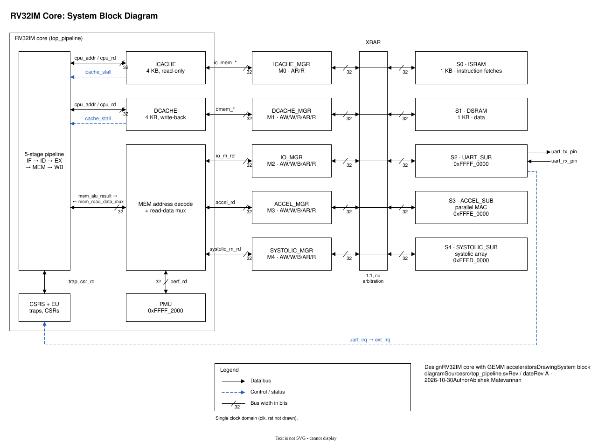
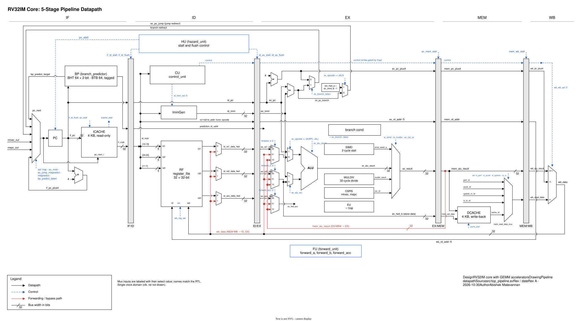
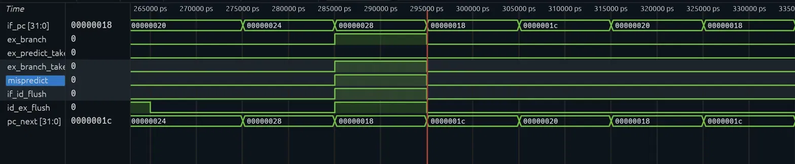
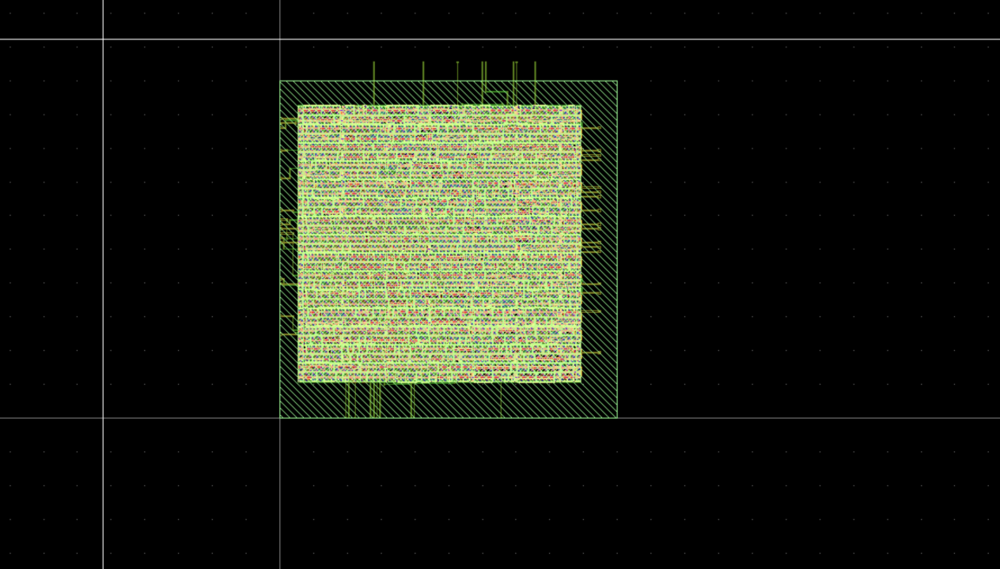
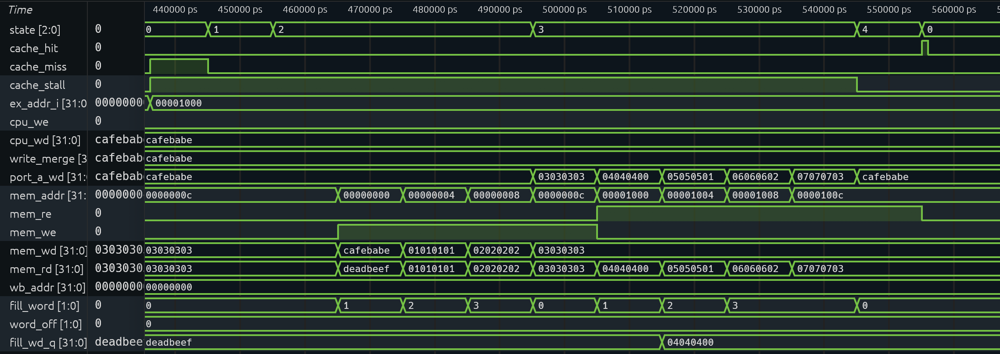
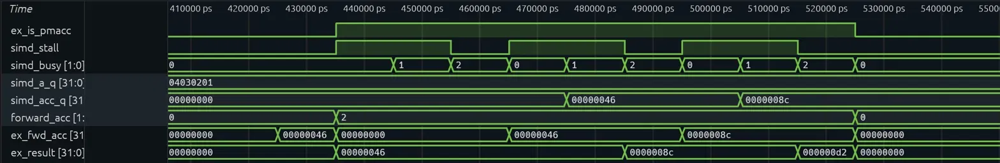
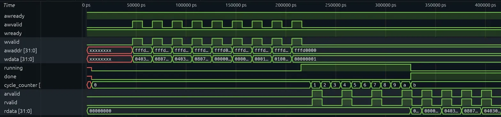

# RISC-V RV32IM Core with GEMM Accelerators

> *"What I cannot create, I do not understand."*
> — Richard Feynman

A RISC-V CPU I designed from scratch in SystemVerilog, with custom hardware for matrix multiply, running at **79 MHz** on a Xilinx Artix-7 FPGA. It passes all 48 official riscv-tests, and it rendered the black hole below.

<p align="center">
  <br>
  <em>Rendered by this CPU in simulation: 228 RISC-V instructions tracing light around a black hole. <a href="blackhole/">How it works</a></em>
</p>

**At a glance**
- **Core:** 5-stage pipeline with forwarding, a 2-bit branch predictor, M-mode traps, and hardware performance counters
- **Memory:** split 4 KB L1 caches on a 5-manager/5-subordinate AXI4-Lite fabric, plus a memory-mapped UART
- **Acceleration:** 4×4 UINT8 matrix multiply vs. scalar RV32M: **3.63×** (SIMD), **13.48×** (parallel MAC), **12.24×** (systolic array)
- **FPGA:** 79 MHz on xc7a200tsbg484-2 (Vivado 2025.2), 14,084 LUTs, 1 BRAM
- **Verification:** 37 self-checking testbenches with SVA, and all 48 riscv-tests (rv32ui + rv32um) passing
- **ASIC:** one accelerator PE taken from RTL to GDSII on Sky130, closing timing at all 9 PVT corners ([asic/](asic/))

## Why I built this

This idea first planted itself in my head in high school, when my computer engineering teacher challenged everyone to make the most powerful PC imaginable under a budget. After hours of slaving away on PCPartPicker, rather than finalizing a build, I only ended up with more questions in my mind. How were certain CPUs faster than others? Why was every good CPU I saw always from AMD, Qualcomm, or Intel? And how in the world is a CPU so small if it is supposed to do copious amounts of math?

These thoughts began to sprout in my high school computer engineering class, where logic gates and the basics of combinational and sequential circuits were taught. To see all this computing power come from minuscule transistors shocked me. To think that basic 0s and 1s were enough to create machines that could change lives. Learning about RISC-V in university made me realize that now was the best time to truly learn how CPUs are built, which began months of learning, errors, and debugging.

The RTL process was an experience I will never forget. Whether it was learning about new modules to implement after finishing one, or spending hours debugging only to realize I forgot to include a reg or wire in a condition, it showed me the fun and excitement of engineering that I had only heard experienced engineers talk about. For the first time, I was excited to find errors in my work, learn from them, and continue the process over and over again.

This project is far from done. There is still so much to fix and learn, like improving the Fmax, and ultimately turning the core into a superscalar pipelined design.


---

## Architecture



### Pipeline datapath

[](docs/diagrams/datapath.svg)

Click to open full size. Both diagrams are drawn from `src/top_pipeline.sv` ([source](docs/diagrams/cpu.drawio)).

---

## Pipeline in Action

A cold branch is fetched past, resolves in EX, and `mispredict` redirects `pc_next` while `if_id_flush`/`id_ex_flush` insert two bubbles in the same cycle. Details in [Waveforms](#waveforms).



---

## Features

### RV32I + RV32M Base ISA
- All 40 base integer instructions, plus MUL/MULH/MULHU/MULHSU/DIV/DIVU/REM/REMU.
- Combinational multiplier on DSP48 slices and a 32-cycle restoring divider.

### 5-Stage Pipeline
- **Forwarding:** EX/MEM and MEM/WB into EX for rs1/rs2, a WB→ID bypass, and a separate accumulator path for PMACC (only when `ex_is_pmacc`).
- **Load-use stall:** one bubble, also covering a load into a PMACC's rd.
- **Branch predictor:** 2-bit BHT plus a tagged 64-entry BTB, trained on branches and JAL/JALR. It flushes only on a mispredict.
- **Cache stalls:** a D$ miss freezes all five stages; an I$ miss holds IF/ID and lets the back end drain.

### L1 Caches
| Cache | Size | Organization | Policy |
|-------|------|-------------|--------|
| Instruction | 4 KB | 256 × 16 B lines, direct-mapped | Read-only |
| Data | 4 KB | 256 × 16 B lines, direct-mapped | Write-back, write-allocate |

### AXI4-Lite Fabric (5M/5S)
Each manager is wired 1:1 to its own subordinate, so there's no arbitration. The MEM stage picks the manager from the address ([Memory Map](#memory-map)).

| Manager | Subordinate |
|---------|-------------|
| I$ | ISRAM: 1 KB, read-only, `$readmemh` init |
| D$ | DSRAM: 1 KB, zero-init |
| IO | UART |
| Accel | Parallel MAC |
| Systolic | Systolic array |

### Traps, UART and PMU
- **M-mode traps:** ECALL, EBREAK, illegal instruction, misaligned load/store and the UART interrupt, plus CSRRW/S/C and MRET.
- **UART** at `0xFFFF0000`: 8N1, 8-entry TX FIFO, RX with a 2-flop synchronizer and an IRQ.
- **PMU** at `0xFFFF2000`: 8 read-only counters (cycles, instructions retired, branches, mispredicts, D$ hits/misses, I$ hits/misses) at +0x00 to +0x1C, 4 bytes apart in that order.

### Custom SIMD Extensions
Seven instructions at custom opcode `0001011`, treating each register as four 8-bit lanes:

| Instruction | funct3 | Operation | Notes |
|-------------|--------|-----------|-------|
| `PADD rd, rs1, rs2` | 000 | `rd[i] = rs1[i] + rs2[i]` | 8-bit unsigned wrap |
| `PSUB rd, rs1, rs2` | 000 | `rd[i] = rs1[i] - rs2[i]` | funct7=0100000 |
| `PMUL rd, rs1, rs2` | 001 | `rd[i] = (rs1[i] × rs2[i])[7:0]` | Lower 8 bits |
| `PDOT rd, rs1, rs2` | 010 | `rd = Σ rs1[i] × rs2[i]` | 32-bit accumulation |
| `PMACC rd, rs1, rs2` | 011 | `rd = rd + PDOT(rs1, rs2)` | rd is src+dst; acc forwarded |
| `PSRA rd, rs1, shamt` | 100 | `rd[i] = rs1[i] >>> shamt` | shamt in funct7[3:0], signed lanes |
| `PRELU rd, rs1` | 101 | `rd[i] = max(0, rs1[i])` | Signed byte interpretation |

PMACC reads rd through a third register-file port, with its own forwarding and load-use handling.

### Pipeline Verification (SVA)
Four invariants are checked on every simulation run (synthesis ignores them):

| Assertion | Location | Property |
|-----------|----------|----------|
| Forwarding one-hot | `forward_unit.sv` | `forward_a` and `forward_b` never `2'b11` |
| x0 hardwired zero | `register_file.sv` | `regs[0] === 32'd0` every cycle |
| Load-use → stall | `hazard_unit.sv` | `load_use_hazard` implies `if_id_stall` |
| AXI awvalid sticky | `top_pipeline.sv` | awvalid holds until awready on all 4 write managers |

### Hardware Accelerators
- **Parallel MAC** (`0xFFFE0000`): all 16 PEs fire on every k-step, so a 4×4 UINT8 GEMM takes 4 compute cycles.
- **Systolic array** (`0xFFFD0000`): Kung-Leiserson output-stationary wavefront, 11 compute cycles.
- **Both have:** K-tiling (CTRL bit 1 keeps `c_acc`), requantization `saturate_uint8((c_acc >> scale_shift) + zero_point)`, and raw INT32 readback at +0x80–0xBC.

---

## Benchmark Results

4×4 UINT8 GEMM (`make sim MODULE=matmul`), measured with the hardware PMU:

| Version | Cycles | Instrs | CPI | Speedup |
|---------|--------|--------|-----|---------|
| Scalar (RV32M `mul`) | 1,065 | 835 | 1.275 | 1.00× |
| SIMD (`PDOT`) | 293 | 195 | 1.503 | 3.63× |
| Parallel MAC | 79 | 22 | 3.59 | 13.48× |
| Systolic Array | 87 | 26 | 3.35 | 12.24× |

- **Scalar:** triple-nested loop with hardware `mul`, 98.3% D$ hit rate.
- **SIMD:** instruction scheduling removes the load-use stall before each PDOT. The 2-cycle SIMD stall added for timing closure raises CPI to 1.503. 96.2% D$ hit rate.
- **Accelerators:** 4 (MAC) and 11 (systolic) compute cycles. The rest is AXI4-Lite setup and readback, which amortizes on larger matrices.
- **16×16 tiled** (`make sim MODULE=matmul_16x16`): all-ones matrices as 16 tiles × 4 K-passes (CTRL=1, then 3). Every C[i][j] = 16, which proves the accumulator chains across passes.

Instruction counts use the corrected PMU (`instr_retired` gated by `!mem_wb_stall`).

---

## Black Hole Ray Tracer Workload

[`blackhole/`](blackhole/) is a 228-instruction general-relativity ray tracer that renders a 64×64 Schwarzschild black hole and sends it over the UART. It exercises the multiplier, divider, predictor, caches and UART together for 5.47M cycles.

- **Fits 1 KB memories:** Q8.24 fixed point, leapfrog integration, CORDIC, and a radial-symmetry table (89 rays instead of 4,096).
- **Bit-exact:** all 4,096 bytes must match `blackhole_ref.py`, and the shadow edge must land on b = 3√3 M.
- **Found a real bug:** DIV returned the previous quotient because the divider didn't stall on its issue cycle. Fixed in [69fa49f](https://github.com/abishekmatevannan-afk/riscv-rv32im-gemm/commit/69fa49f), with `tb_div_pipeline` as the regression test.

| Cycles | Instructions | CPI | Branch mispredicts | D$ misses | I$ misses |
|--------|--------------|-----|--------------------|-----------|-----------|
| 5,468,472 | 4,039,097 | 1.354 | 2.63% | 51 | 58 |

Run it with `cd blackhole && make`. Physics and build details are in [`blackhole/README.md`](blackhole/README.md).

---

## FPGA Implementation

**Target:** Xilinx Artix-7 xc7a200tsbg484-2 · **Tool:** Vivado 2025.2 · **Constraint:** 100 MHz

### Fmax Progression

| Step | WNS | Fmax |
|------|-----|------|
| Baseline | -7.787 ns | ~57 MHz |
| `ex_addr_i = ex_alu_result` | -4.467 ns | ~69 MHz |
| `wb_csr_rd` removed | -3.670 ns | ~73 MHz |
| Registered SIMD inputs + 2-cycle stall | -2.730 ns | **~79 MHz** |

### Final Implementation (79 MHz)

| Metric | Value |
|--------|-------|
| Slice LUTs | 14,084 |
| Slice Registers | 5,399 |
| Block RAM Tile | 1 (icache, RAMB36E1) |
| DSP48E1 | 8 (multiplier) |
| WNS | -2.730 ns |
| Failing endpoints | 1,679 / 20,318 |

The critical path is branch resolution in EX: forwarding → ALU compare → `branch_taken` → mispredict flush → I$ valid bit (12.401 ns, 17 logic levels). The multiplier path is 0.06 ns behind. Full breakdown in `SYNTHESIS.md`.

---

## FPGA vs. ASIC: PE Cell Comparison

One accelerator PE taken through an open-source ASIC flow, next to the Vivado result. The full write-up and every ruled-out hypothesis are in [`asic/README.md`](asic/README.md).



*Layout from the earlier single-cycle run, before the MAC was pipelined.*

| Metric | FPGA (Vivado, Artix-7) | ASIC (LibreLane, Sky130 130nm) |
|--------|------------------------|----------------------------------|
| Target | xc7a200tsbg484-2 | sky130_fd_sc_hd |
| Clock constraint | 10 ns (100 MHz) | 16 ns (62.5 MHz) |
| Achieved result | 79 MHz (part of full design) | Closes at all 9 PVT corners, +0.180 ns worst slack (ss, 100°C) |
| Cell count | — (absorbed into 14,084 LUTs) | 706 standard cells (excluding fill) |
| Area | — | 5,285.07 µm² std-cell, 7,607.30 µm² core |
| Multiplier mapping | DSP48E1 for RV32M; accelerator PE multiplies in LUTs | Synthesized from standard cells |
| Critical path | Branch resolution: forwarding → ALU compare → flush → I-cache valid (12.401 ns) | Input operand → 8×8 multiplier → product register (MAC pipelined into two stages) |
| Output artifact | Bitstream | GDSII |

---

## Waveforms

Four captures from the simulation testbenches. Each caption was checked cycle by cycle against a fresh VCD.

### D$ dirty-line eviction and refill (`make wave MODULE=dcache`)



Scope `tb_dcache → dut`, 435–565 ns (`state[2:0]`, `cache_miss`, `cache_stall`, `mem_addr`, `mem_we`, `mem_wd`, `mem_re`, `mem_rd`, plus internal fill signals).

- Test 5 writes 0xCAFEBABE to word 0 of the line at 0x0000, then reads 0x1000. Same index, different tag, so it misses at 436 ns.
- The FSM goes WB_PREP → WRITEBACK → FILL → DONE. The writeback sends 0xCAFEBABE, 0x01010101, 0x02020202 and 0x03030303 to 0x0–0xC, so only word 0 had changed.
- The last writeback word goes out in the first FILL cycle; then the reads fetch 0x1000–0x100C.
- `cache_stall` stays high from the miss until DONE at 545 ns.

### Branch mispredict redirect and pipeline flush (`make wave MODULE=top_pipeline`)


Scope `tb_top_pipeline → cpu1`, 260–335 ns (`if_pc`, `ex_branch`, `ex_predict_taken`, `ex_branch_taken`, `mispredict`, `if_id_flush`, `id_ex_flush`, `pc_next`).

- The loop in `test1.hex` is `add` (0x18), `addi x6` (0x1C) and `bne x6, x0, -8` (0x20). The BTB is cold, so IF fetches straight on.
- At 285 ns the branch resolves in EX while `if_pc` is already 0x28. It was predicted not taken, so `mispredict` fires, `pc_next` becomes 0x18, and both flushes turn 0x24 and 0x28 into bubbles: a 2-cycle penalty.
- On the second pass (315 ns) `pc_next` already points to 0x18 when `if_pc` is 0x20, so nothing is flushed.

### PMACC accumulator forwarding chain (`make wave MODULE=pmacc_pipeline`)



Scope `tb_pmacc_pipeline → cpu`, 415–540 ns (`ex_is_pmacc`, `simd_stall`, `simd_busy[1:0]`, `simd_a_q`, `simd_acc_q`, `forward_acc[1:0]`, `ex_fwd_acc`, `ex_result`).

- Three back-to-back PMACCs (0x30, 0x34, 0x38) accumulate into one register while each previous result is still in EX/MEM.
- `forward_acc` = 2 (EX/MEM) for all three, and the sum goes **0x46 → 0x8c → 0xd2** (70 → 140 → 210).
- Each PMACC still takes the SIMD unit's 2 stall cycles (`simd_busy` 0→1→2), but none waits for writeback.
- `ex_result` shows 0x46 before the first PMACC computes. That's a stale `simd_result_q` from test 1, which also computed 70.

### Systolic array end-to-end AXI transaction (`make wave MODULE=systolic_array`)



Top scope of `tb_systolic_array`, plus `running`, `done` and `cycle_counter[3:0]` in `→ dut`, 0–420 ns.

- 9 single-beat AXI4-Lite writes (AXI4-Lite has no bursts): A_ROW0–3 (0x10–0x1C), B_ROW0–3 (0x20–0x2C), then CTRL = 1 at 0x00.
- The array computes for 11 cycles. `done` asserts when `cycle_counter` reaches 0xB, while the testbench polls STATUS (0x04) and reads 0.
- After `done` it reads CYCLES (0x08 = 11) and the C rows from 0x40. B is the identity matrix, so C equals A (0x04030201, 0x08070605, …).
- Seeing the wavefront inside the array would need probes on `feed_gen`/`bfeed_gen`, which aren't added yet.

---

## Memory Map

| Address | Description |
|---------|-------------|
| `0x00000000` | Instruction SRAM (via I$, 1 KB; every fetch goes here, aliasing every 1 KB) |
| `0x00000000`–`0xFFFCFFFF` | Data SRAM (via D$, 1 KB, separate Harvard path; aliases every 1 KB) |
| `0xFFFF0000` | UART TX/RX (all of `0xFFFFxxxx` except the PMU) |
| `0xFFFF2000` | PMU counters (8 × 4B) |
| `0xFFFD0000` | Systolic Array registers |
| `0xFFFD0030` | Systolic SCALE_SHIFT (5-bit) |
| `0xFFFD0034` | Systolic ZERO_POINT (8-bit) |
| `0xFFFD0080` | Systolic C_UINT32 readback (16 × 4B) |
| `0xFFFE0000` | Parallel MAC registers |
| `0xFFFE0030` | Parallel MAC SCALE_SHIFT |
| `0xFFFE0034` | Parallel MAC ZERO_POINT |
| `0xFFFE0080` | Parallel MAC C_UINT32 readback (16 × 4B) |

---

## Project Structure

```
riscv-rv32im-gemm/
├── src/                      # RTL
│   ├── top_pipeline.sv       # 5-stage pipeline top level
│   ├── top.sv                # single-cycle core (regression baseline)
│   ├── control_unit.sv       # RV32IM + custom opcode decode
│   ├── forward_unit.sv       # rs1/rs2/acc forwarding selects
│   ├── hazard_unit.sv        # stalls and flushes
│   ├── branch_predictor.sv   # 2-bit BHT + tagged BTB
│   ├── register_file.sv      # 3 read ports (rs1, rs2, acc)
│   ├── mul_div_unit.sv       # RV32M
│   ├── simd_alu.sv           # the 7 SIMD instructions
│   ├── icache.sv / dcache.sv # 4 KB L1 caches
│   ├── axi4_lite_*.sv        # interconnect, managers, subordinates
│   ├── parallel_mac_sub.sv   # 4×4 MAC accelerator
│   └── systolic_array_sub.sv # 4×4 systolic accelerator
├── tb/                       # 37 self-checking testbenches
├── tests/riscv/              # riscv-tests harness
├── programs/                 # hex programs (tests, GEMM benchmarks)
├── blackhole/                # ray tracer workload
├── asic/                     # Sky130 pe_cell flow
├── docs/                     # diagrams and waveforms
└── Makefile
```

---

## Getting Started

```bash
brew install icarus-verilog      # macOS
sudo apt install iverilog        # Ubuntu / WSL
```

```bash
make test-all          # expected: 37 passed   0 failed
make riscv-tests       # expected: 48 passed   0 failed
```

The riscv-tests programs are prebuilt in `programs/riscv-tests/`. To rebuild them, install a RISC-V GCC (e.g. [xPack riscv-none-elf-gcc](https://github.com/xpack-dev-tools/riscv-none-elf-gcc-xpack/releases)) and run `make riscv-tests-build`.

```bash
# individual modules
make sim MODULE=simd_alu
make sim MODULE=pmacc
make sim MODULE=pmacc_pipeline
make sim MODULE=hazard_unit
make sim MODULE=forward_unit
make sim MODULE=dcache
make sim MODULE=icache
make sim MODULE=parallel_mac
make sim MODULE=systolic_array
make sim MODULE=mul_div

# matrix multiply benchmark
make sim MODULE=matmul
# Scalar:       1065 cycles   835 instrs   CPI=1.275   1.00x
# SIMD:          293 cycles   195 instrs   CPI=1.503   3.63x
# Parallel MAC:   79 cycles    22 instrs   CPI=3.59   13.48x
# Systolic:       87 cycles    26 instrs   CPI=3.35   12.24x

# waveforms
make wave MODULE=top_pipeline
make wave MODULE=pmacc_pipeline
```

---

## Verification

| Module | Tests | Status |
|--------|-------|--------|
| ALU | All RV32I operations | ✅ |
| MUL/DIV | RV32M MUL/MULH/DIV/REM variants (unit + in-pipeline) | ✅ |
| Register file | 3-port read, x0 hardwired | ✅ |
| Control unit | All RV32IM + custom opcodes | ✅ |
| Forward unit | EX/MEM, MEM/WB, acc (PMACC) | ✅ |
| Hazard unit | load-use, branch flush, PMACC acc stall | ✅ |
| SIMD ALU | PADD/PSUB/PMUL/PDOT/PMACC/PSRA/PRELU | ✅ |
| PMACC unit | acc=0, chain, large INT32 | ✅ |
| PMACC pipeline | All 4 forwarding paths end-to-end | ✅ |
| PSRA/PRELU pipeline | All forwarding paths end-to-end | ✅ |
| D$ cache | Miss, fill, writeback, bypass | ✅ |
| I$ cache | Miss, fill, invalidate | ✅ |
| Branch predictor | BHT update, BTB, mispredict flush | ✅ |
| AXI4-Lite fabric | 5M/5S routing, all subordinates | ✅ |
| Parallel MAC | Baseline, overflow, requant, K-tiling | ✅ |
| Systolic Array | Same suite at 0xFFFD | ✅ |
| UART TX/RX | 8N1 framing, FIFO, IRQ | ✅ |
| Exception handling | ECALL, MRET, illegal, IRQ, stack save/restore | ✅ |
| Precise traps | IRQ on a bubble resumes at a real PC, interrupted instruction runs once, misaligned store doesn't write memory | ✅ |
| Performance counters | All 8 counters via PMU | ✅ |
| 16×16 tiled matmul | Accumulate mode (CTRL bit 1), 4 K-passes → C[i][j]=16 | ✅ |
| Single-cycle CPU | Regression baseline | ✅ |
| Pipelined CPU | test1, test2, exception, matmul | ✅ |
| SVA assertions | forwarding one-hot, x0 invariant, load-use→stall, AXI awvalid sticky (all 4 channels) | ✅ |
| PE cell (ASIC) | reset, en=0 hold, PDOT cross-validation, K-tile chain, signed/unsigned discriminator, product latency, en during reset, en bubbles | ✅ |
| **Total** | **37 testbenches** | **37/37** |

### ISA compliance: official riscv-tests

The core passes the official [riscv-tests](https://github.com/riscv-software-src/riscv-tests) `rv32ui` and `rv32um` suites: **48/48**, which covers every RV32I and RV32M instruction plus the `ld_st`/`st_ld` ordering tests.

| Suite | Tests | Result |
|-------|-------|--------|
| rv32ui (base integer) | 40 | 40/40 ✅ |
| rv32um (multiply/divide) | 8 | 8/8 ✅ |

- **Harness:** a minimal M-mode environment (`tests/riscv/env/riscv_test.h`) and a Harvard linker script (`tests/riscv/link.ld`: code at 0x0000, data at 0x2000). The ELF is split into one hex file per memory.
- **Reporting:** each test stores to `TOHOST` (0x3FFC). `tests/riscv/tb_riscv_tests.sv` catches the store in MEM, before the write-back D$. A deliberate "fail case 3" program and a hang program prove that `FAIL` and `TIMEOUT` are detected.
- **Pinned** to riscv-tests commit `7b68f7b`.
- **Excluded:** `fence_i` (ISRAM is read-only) and `ma_data` (misaligned accesses trap, which the spec allows).

**Bugs these tests found** (all fixed). The first three were hidden because every existing testbench started with zeroed DSRAM:

1. **D$ refill one slot off:** `mem_rd` lags `fill_word` by a cycle, so word *k* got word *k−1*'s data. Fixed by indexing the refill write with `mem_addr[3:2]`.
2. **Load misses returned the raw word:** missed `lb`/`lbu`/`lh`/`lhu` skipped byte/halfword extraction.
3. **`sb`/`sh` store misses overwrote the whole word** instead of merging into the refilled word.
4. **MULHSU computed unsigned × unsigned:** `$signed(a) * b` evaluates unsigned in Verilog. Both operands are now 33-bit signed, and `tb_mul_div`'s wrong expected value (`0xFFFFFFFE` instead of `0xFFFFFFFF`) was corrected.

---

## Known Limitations

- **Direct-mapped caches:** aliasing working sets cause conflict misses; 2-way set-associative is the next step.
- **Direct-mapped BTB:** tags prevent wrong redirects, but colliding PCs still evict each other.
- **No `fence.i`:** ISRAM is read-only (Harvard).
- **No misaligned loads/stores in hardware:** they trap.
- **D$ in LUT RAM, not BRAM:** the write-hit forwarding path blocks BRAM inference (RAM64M×176). See `SYNTHESIS.md`.

---

## Tools

| Tool | Version | Purpose |
|------|---------|---------|
| Icarus Verilog | 11+ | RTL simulation |
| Wavetrace (VS Code) | any | Waveform analysis |
| Vivado | 2025.2 | Synthesis and implementation (see `SYNTHESIS.md`) |
| GNU Make | any | Build automation |
| Git | any | Version control |

---

*3rd year Computer Engineering — Toronto Metropolitan University*
