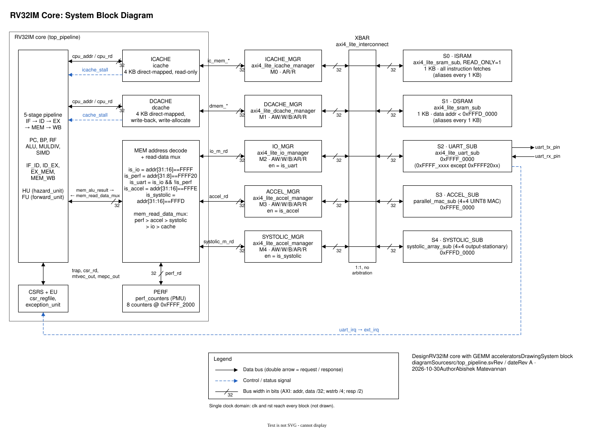
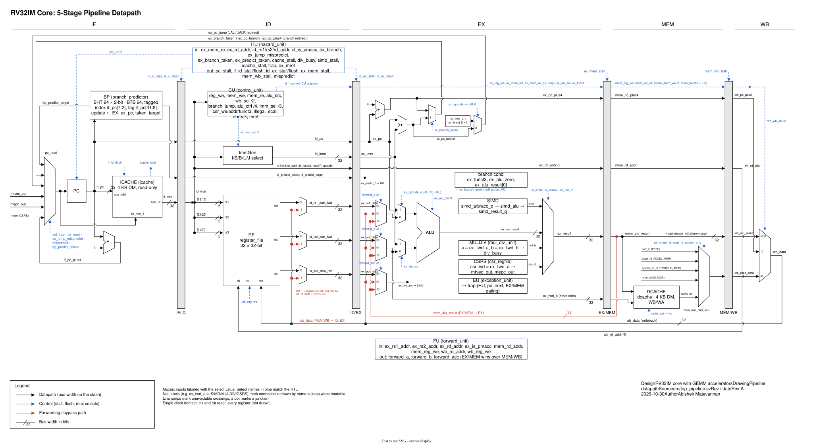
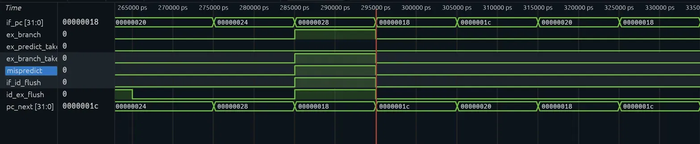
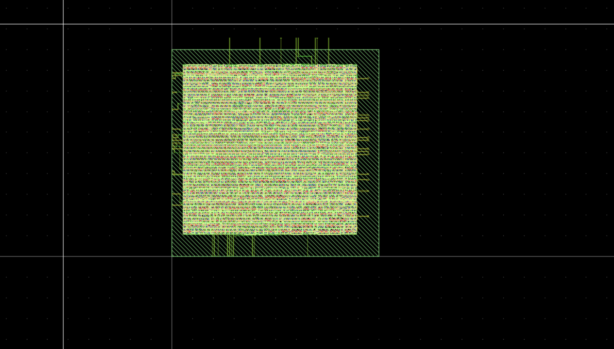
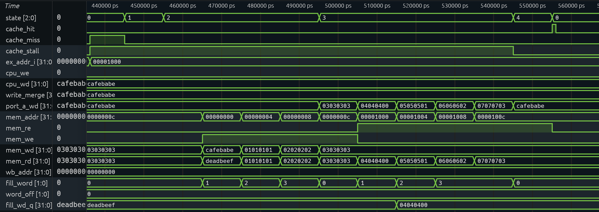
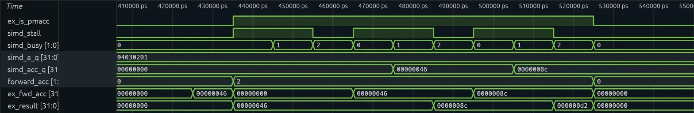
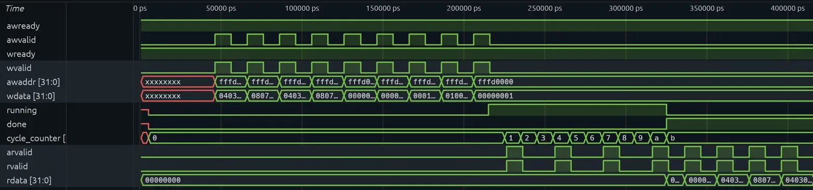

# RISC-V RV32IM Core with GEMM Accelerators

> *"What I cannot create, I do not understand."*
> — Richard Feynman

A RISC-V CPU I designed from scratch in SystemVerilog, with custom hardware for matrix multiply, running at **79 MHz** on a Xilinx Artix-7 FPGA. It passes all 48 official riscv-tests, and it rendered the black hole below.

<p align="center">
  <br>
  <em>Rendered by this CPU in simulation: 228 RISC-V instructions tracing light around a black hole. <a href="blackhole/">How it works</a></em>
</p>

**At a glance**
- **Core:** 5-stage pipeline with forwarding, a 2-bit branch predictor, precise M-mode traps, and hardware performance counters
- **Memory:** split 4 KB L1 caches on a 5-manager/5-subordinate AXI4-Lite fabric, plus a memory-mapped UART
- **Acceleration:** 4×4 UINT8 matrix multiply vs. scalar RV32M: **3.63×** (SIMD), **13.48×** (parallel MAC), **12.24×** (systolic array)
- **FPGA:** 79 MHz on xc7a200tsbg484-2 (Vivado 2025.2), 14,084 LUTs, 1 BRAM
- **Verification:** 37 self-checking testbenches with SVA, and all 48 riscv-tests (rv32ui + rv32um) passing
- **ASIC:** one accelerator PE taken from RTL to GDSII on Sky130, closing timing at all 9 PVT corners ([asic/](asic/))

## Why I built this

This idea first planted itself in my head in high school, when my computer engineering teacher challenged everyone to make the most powerful PC imaginable under a budget. After hours of slaving away on PCPartPicker, rather than finalizing a build, I only ended up with more questions in my mind. How were certain CPUs faster than others? Why was every good CPU I saw always from AMD, Qualcomm, or Intel? And how in the world is a CPU so small if it is supposed to do copious amounts of math?

These thoughts began to sprout in my high school computer engineering class, where logic gates and the basics of combinational and sequential circuits were taught. To see all this computing power come from minuscule transistors shocked me. To think that basic 0s and 1s were enough to create machines that could change lives. Learning about RISC-V in university made me realize that now was the best time to truly learn how CPUs are built, which began months of learning, errors, and debugging.

The RTL process was an experience I will never forget. Whether it was learning about new modules to implement after finishing one, or spending hours debugging only to realize I forgot to include a reg or wire in a condition, it showed me the fun and excitement of engineering that I had only heard experienced engineers talk about. For the first time, I was excited to find errors in my work, learn from them, and continue the process over and over again.

This project is far from done. There is still so much to fix and learn, like improving the Fmax, and ultimately turning the core into a superscalar pipelined design.


---

## Architecture



### Pipeline datapath

[](docs/diagrams/datapath.svg)

Click the image to open it full size. It shows all four pipeline registers, the forwarding and WB→ID bypass paths, the branch and jump redirect, and the hazard, forwarding and branch-predictor control. Both diagrams are drawn from `src/top_pipeline.sv`, and the source is [`docs/diagrams/cpu.drawio`](docs/diagrams/cpu.drawio).

---

## Pipeline in Action

Branch mispredict: the predictor defaults to sequential fetch, and when the branch resolves in EX, `mispredict` asserts, `pc_next` redirects to the correct target, and `if_id_flush`/`id_ex_flush` insert two bubbles in the same cycle.



Signals: `if_pc`, `ex_branch`, `ex_predict_taken`, `ex_branch_taken`, `mispredict`, `if_id_flush`, `id_ex_flush`, `pc_next` · scope: `tb_top_pipeline → cpu1` · zoom ~285 ns. Full waveform analysis in the [Waveforms](#waveforms) section.

---

## Features

### RV32I + RV32M Base ISA
All 40 base integer instructions (R, I, S, B, U, J formats plus FENCE, ECALL, EBREAK). Hardware multiply/divide unit: MUL, MULH, MULHU, MULHSU, DIV, DIVU, REM, REMU, using a 32-cycle restoring divider and a combinational multiplier that maps to DSP48 on Xilinx targets.

### 5-Stage Pipeline
- **Data forwarding**: EX/MEM and MEM/WB paths for rs1/rs2, plus a dedicated acc forwarding path for PMACC (gated on `ex_is_pmacc` to prevent false forwards)
- **Load-use stall**: a 1-cycle bubble for load→use, extended to cover the PMACC accumulator port (load→PMACC with same rd stalls)
- **Branch predictor**: 2-bit saturating counter BHT with 64-entry BTB, trained on JAL/JALR/branches, and flushes only on misprediction
- **Cache stall**: all five stages frozen during a D$ miss, and IF/ID frozen with a bubble on an I$ miss

### L1 Cache Hierarchy
| Cache | Size | Organization | Policy |
|-------|------|-------------|--------|
| Instruction | 4KB | 256 lines × 16 bytes, direct-mapped | Read-only |
| Data | 4KB | 256 lines × 16 bytes, direct-mapped | Write-back, write-allocate |

Both caches back onto the AXI4-Lite fabric via dedicated manager modules.

### AXI4-Lite Memory Fabric (5M/5S)
Point-to-point interconnect: each of the five managers (icache, dcache, IO, parallel MAC, systolic array) has its own dedicated subordinate, so no arbitration is needed. The MEM stage decodes each load or store address to choose the manager:

| Subordinate | Address | Description |
|-------------|---------|-------------|
| ISRAM | all instruction fetches | 1 KB instruction SRAM (read-only, `$readmemh` init), aliases every 1 KB |
| DSRAM | data addresses below `0xFFFD0000` | 1 KB data SRAM (read/write, zero-init), aliases every 1 KB |
| UART | `0xFFFF0000` | UART TX/RX subordinate (all of `0xFFFFxxxx` except the PMU at `0xFFFF20xx`) |
| Parallel MAC | `0xFFFE0000` | 4×4 PE grid accelerator |
| Systolic Array | `0xFFFD0000` | Output-stationary wavefront accelerator |

### M-Mode Exception Handling
Full trap/return pipeline: ECALL, illegal instruction, load/store misalign, external IRQ. CSR instructions CSRRW, CSRRS, CSRRC. MRET restores PC from mepc and re-enables interrupts.

### UART TX/RX
Memory-mapped at `0xFFFF0000` on the AXI4-Lite bus. 8-entry TX FIFO, 8N1 framing, status polling. RX path with 2-flop synchronizer, falling-edge start-bit detection, and IRQ output.

### Hardware PMU
8 read-only counters at `0xFFFF2000`:

| Offset | Counter |
|--------|---------|
| +0x00 | Cycle count |
| +0x04 | Instructions retired |
| +0x08 | Branches executed |
| +0x0C | Branch mispredictions |
| +0x10 | D$ hits |
| +0x14 | D$ misses |
| +0x18 | I$ hits |
| +0x1C | I$ misses |

### Custom SIMD Extensions
Seven instructions at RISC-V custom opcode `0001011`, operating on 32-bit registers as packed 4×8-bit vectors:

| Instruction | funct3 | Operation | Notes |
|-------------|--------|-----------|-------|
| `PADD rd, rs1, rs2` | 000 | `rd[i] = rs1[i] + rs2[i]` | 8-bit unsigned wrap |
| `PSUB rd, rs1, rs2` | 000 | `rd[i] = rs1[i] - rs2[i]` | funct7=0100000 |
| `PMUL rd, rs1, rs2` | 001 | `rd[i] = (rs1[i] × rs2[i])[7:0]` | Lower 8 bits |
| `PDOT rd, rs1, rs2` | 010 | `rd = Σ rs1[i] × rs2[i]` | 32-bit accumulation |
| `PMACC rd, rs1, rs2` | 011 | `rd = rd + PDOT(rs1, rs2)` | rd is src+dst; acc forwarded |
| `PSRA rd, rs1, shamt` | 100 | `rd[i] = rs1[i] >>> shamt` | shamt in funct7[3:0], signed lanes |
| `PRELU rd, rs1` | 101 | `rd[i] = max(0, rs1[i])` | Signed byte interpretation |

**PMACC** reads `rd` as a third source (accumulator), writes back `rd + PDOT(rs1, rs2)`. The register file has a dedicated third read port, and the hazard unit and forward unit both handle the accumulator path independently from rs1/rs2.

### Pipeline Verification (SVA)
Four invariants are checked as SystemVerilog assertions at simulation time, since synthesizers treat them as no-ops while iverilog evaluates them on every testbench run:

| Assertion | Location | Property |
|-----------|----------|----------|
| Forwarding one-hot | `forward_unit.sv` | `forward_a` and `forward_b` never `2'b11` (undefined mux select) |
| x0 hardwired zero | `register_file.sv` | `regs[0] === 32'd0` on every clock cycle |
| Load-use → stall | `hazard_unit.sv` | `load_use_hazard` implies `if_id_stall` |
| AXI awvalid sticky | `top_pipeline.sv` | awvalid stays high until awready on all 4 AXI channels |

Any violation fires `$error` during simulation, and `make test-all` catches it automatically.

### Hardware Accelerators

**Parallel MAC** (`0xFFFE0000`): 4×4 PE grid where all 16 PEs fire in parallel each k-step. Computes a full 4×4 UINT8 GEMM in 4 cycles. Supports:
- Tile-K accumulation (CTRL bit 1 preserves `c_acc` across passes for K > 4)
- Requantization: `saturate_uint8((c_acc >> scale_shift) + zero_point)`
- Raw INT32 readback at `0xFFFE0080–0xFFFE00BC`

**Systolic Array** (`0xFFFD0000`): Kung-Leiserson output-stationary wavefront. Compute latency 11 cycles (wavefront fill + drain). Same register map, accumulate mode, and requantization interface as the parallel MAC.

---

## Benchmark Results

4×4 UINT8 GEMM (`make sim MODULE=matmul`), measured via hardware PMU:

| Version | Cycles | Instrs | CPI | Speedup |
|---------|--------|--------|-----|---------|
| Scalar (RV32M `mul`) | 1,065 | 835 | 1.275 | 1.00× |
| SIMD (`PDOT`) | 293 | 195 | 1.503 | 3.63× |
| Parallel MAC | 79 | 22 | 3.59 | 13.48× |
| Systolic Array | 87 | 26 | 3.35 | 12.24× |

Instruction counts measured with corrected PMU (`instr_retired` gated by `!mem_wb_stall`, since prior versions overcounted during stall cycles).

**Scalar**: hardware `mul` (RV32M), 4×4 triple-nested loop. D$ hit rate 98.3%.  
**SIMD**: load-use stall before each PDOT eliminated by scheduling three independent C-address instructions into the stall slot. D$ hit rate 96.2%. Higher CPI (1.503) reflects the two-stall-cycle cost of registered SIMD inputs added for timing closure.  
**Parallel MAC**: 4-cycle PE compute, and the remaining 57 cycles are AXI4-Lite register writes. High CPI (3.59) is AXI setup overhead dominating a 4×4 problem, and it amortizes at larger matrix sizes.  
**Systolic Array**: 11-cycle wavefront fill/drain, 61 cycles AXI overhead. Same overhead story as parallel MAC.

**16×16 tiled matmul** (`make sim MODULE=matmul_16x16`): A=B=all-1s (16×16), tiled as 16 output tiles of 4×4 with 4 K-passes each. First K-pass uses CTRL=1 (clears `c_acc`), and the subsequent three use CTRL=3 (preserve `c_acc`). Result: C[i][j]=16 for all entries (one pass gives 4, four accumulated passes give 16). Proves the INT32 accumulator correctly chains K > 4 passes, which is exactly the feature that answers the question *"how does your accelerator handle matrices larger than the PE array?"*

---

## Black Hole Ray Tracer Workload

[`blackhole/`](blackhole/) is a general-relativity ray tracer written in 228 RISC-V instructions. It renders a 64×64 Schwarzschild black hole on `top_pipeline` in simulation and sends the image out over the UART. It stresses the multiplier, divider, branch predictor, caches and UART together for 5.47M cycles, which the matmul benchmarks don't.

- **Fits 1 KB memories:** Q8.24 fixed point, leapfrog integration, CORDIC for sin/cos, and a radial-symmetry table (89 rays traced instead of 4,096).
- **Bit-exact:** all 4,096 bytes from the UART must match `blackhole_ref.py`, a Python copy of the same integer algorithm. The shadow edge must also land on GR's critical impact parameter, b = 3√3 M.
- **Found a real bug:** DIV in the pipeline returned the previous quotient because the divider didn't stall on its issue cycle. The divider's own unit test couldn't see it. Fixed in [69fa49f](https://github.com/abishekmatevannan-afk/riscv-rv32im-gemm/commit/69fa49f), with `tb_div_pipeline` as the regression test.

| Cycles | Instructions | CPI | Branch mispredicts | D$ misses | I$ misses |
|--------|--------------|-----|--------------------|-----------|-----------|
| 5,468,472 | 4,039,097 | 1.354 | 2.63% | 51 | 58 |

Run it with `cd blackhole && make`. See [`blackhole/README.md`](blackhole/README.md) for the physics and how it's built.

---

## FPGA Implementation

**Target:** Xilinx Artix-7 xc7a200tsbg484-2 · **Tool:** Vivado 2025.2 · **Constraint:** 100 MHz

### Fmax Progression

| Step | WNS | Fmax |
|------|-----|------|
| Baseline | -7.787 ns | ~57 MHz |
| `ex_addr_i = ex_alu_result` | -4.467 ns | ~69 MHz |
| `wb_csr_rd` removed | -3.670 ns | ~73 MHz |
| Registered SIMD inputs + 2-cycle stall | -2.730 ns | **~79 MHz** |

### Final Implementation (79 MHz)

| Metric | Value |
|--------|-------|
| Slice LUTs | 14,084 |
| Slice Registers | 5,399 |
| Block RAM Tile | 1 (icache, RAMB36E1) |
| DSP48E1 | 8 (multiplier) |
| WNS | -2.730 ns |
| Failing endpoints | 1,679 / 20,318 |

Critical path: branch resolution in EX, from EX/MEM forwarding → ALU compare → `branch_taken` → mispredict flush → I-cache valid bit (12.401 ns data path, 17 logic levels). The single-cycle multiplier path is 0.06 ns behind. See `SYNTHESIS.md` for full utilization breakdown and path analysis.

---

## FPGA vs. ASIC: PE Cell Comparison

Two designs taken through an open-source ASIC flow to compare with the FPGA implementation in Vivado. Full writeup, setup instructions, and every ruled-out hypothesis in [`asic/README.md`](asic/README.md).



*Layout from the earlier single-cycle run, before the MAC was pipelined.*

| Metric | FPGA (Vivado, Artix-7) | ASIC (LibreLane, Sky130 130nm) |
|--------|------------------------|----------------------------------|
| Target | xc7a200tsbg484-2 | sky130_fd_sc_hd |
| Clock constraint | 10 ns (100 MHz) | 16 ns (62.5 MHz) |
| Achieved result | 79 MHz (part of full design) | Closes at all 9 PVT corners, +0.180 ns worst slack (ss, 100°C) |
| Cell count | — (absorbed into 14,084 LUTs) | 706 standard cells (excluding fill) |
| Area | — | 5,285.07 µm² std-cell, 7,607.30 µm² core |
| Multiplier mapping | DSP48E1 for RV32M; accelerator PE multiplies in LUTs | Synthesized from standard cells |
| Critical path | Branch resolution: forwarding → ALU compare → flush → I-cache valid (12.401 ns) | Input operand → 8×8 multiplier → product register (MAC pipelined into two stages) |
| Output artifact | Bitstream | GDSII |

---

## Waveforms

Four captures from my simulation testbenches. For each one I re-ran the test and checked the caption against the VCD cycle by cycle, so every value and timestamp below is what the simulator actually produced.

### D$ dirty-line eviction and refill (`make wave MODULE=dcache`)



Signals: `state[2:0]`, `cache_hit`, `cache_miss`, `cache_stall`, `ex_addr_i`, `cpu_we`, `cpu_wd`, `write_merge`, `port_a_wd`, `mem_addr`, `mem_re`, `mem_we`, `mem_wd`, `mem_rd`, `wb_addr`, `fill_word[1:0]`, `word_off[1:0]`, `fill_wd_q`, all in `tb_dcache → dut`. Zoom to 435–565 ns.

This is test 5 in `tb_dcache`. It first writes 0xCAFEBABE to word 0 of the line at 0x0000, which marks that line dirty. Then it reads 0x1000. Both addresses land on cache index 0 with different tags, so the read misses (`cache_miss` pulses at 436 ns) and the cache has to get rid of the dirty line before it can bring the new one in.

The FSM goes WB_PREP → WRITEBACK → FILL → DONE. During WRITEBACK the old line goes back to memory one word at a time: 0xCAFEBABE at 0x0, then 0x01010101, 0x02020202 and 0x03030303 at 0x4, 0x8 and 0xC. Those last three are the values the line was originally filled with, so only word 0 changed. The final word is still being written during the first FILL cycle, and the reads for the new line (0x1000 to 0x100C) start the cycle after that. `cache_stall` stays high from the miss until the FSM reaches DONE at 545 ns, which is how long the pipeline would sit frozen.

### Branch mispredict redirect and pipeline flush (`make wave MODULE=top_pipeline`)


Signals: `if_pc`, `ex_branch`, `ex_predict_taken`, `ex_branch_taken`, `mispredict`, `if_id_flush`, `id_ex_flush`, `pc_next`, all in `tb_top_pipeline → cpu1`. Zoom to 260–335 ns.

The loop in `test1.hex` is three instructions: an `add` at 0x18, an `addi` at 0x1C that counts x6 down, and `bne x6, x0, -8` at 0x20 that jumps back to 0x18. This is the first time the branch runs, so the BTB has no entry for it and IF just keeps fetching in order.

The branch resolves in EX at 285 ns. By then IF has already moved two instructions past it (`if_pc` is 0x28). The branch is taken but was predicted not taken, so `mispredict` goes high, `pc_next` switches to 0x18 in the same cycle, and `if_id_flush` and `id_ex_flush` fire together. That turns the two wrong-path instructions at 0x24 and 0x28 into bubbles, so the mispredict costs two cycles. `if_pc` is 0x18 on the next cycle.

You can also see the predictor learn. On the second pass through the loop (315 ns), `if_pc` is 0x20 and `pc_next` already points to 0x18, so the branch is predicted taken and nothing gets flushed.

### PMACC accumulator forwarding chain (`make wave MODULE=pmacc_pipeline`)



Signals: `ex_is_pmacc`, `simd_stall`, `simd_busy[1:0]`, `simd_a_q`, `simd_acc_q`, `forward_acc[1:0]`, `ex_fwd_acc`, `ex_result`, all in `tb_pmacc_pipeline → cpu`. Zoom to 415–540 ns.

This is test 2 of `pmacc_test.hex`: three PMACC instructions back to back (0x30, 0x34, 0x38) that all accumulate into the same register. Each one needs the previous one's result as its accumulator, but that result is still sitting in EX/MEM and hasn't been written to the register file yet. `forward_acc` stays at 2 (forward from EX/MEM) for all three, so `ex_fwd_acc` picks up the newest total every time. The first PMACC gets its starting value of 0 the same way, from the `addi` right before it.

The running sum goes **0x46 → 0x8c → 0xd2** (70 → 140 → 210), and `simd_acc_q` shows each PMACC starting from the previous total. Each PMACC still takes the SIMD unit's own two stall cycles (`simd_busy` 0→1→2), but forwarding means none of them waits extra for the previous result to reach writeback.

One thing that looks odd: `ex_result` already shows 0x46 the moment the first PMACC enters EX. That's an old `simd_result_q` left over from test 1, which also computed 70. The first PMACC's real result is the same number, so the value doesn't visibly change.

### Systolic array end-to-end AXI transaction (`make wave MODULE=systolic_array`)



Signals: `awvalid`, `awready`, `wvalid`, `wready`, `awaddr`, `wdata`, `arvalid`, `rvalid`, `rdata` in the `tb_systolic_array` top scope, plus `running`, `done` and `cycle_counter[3:0]` in `tb_systolic_array → dut`. Zoom to 0–420 ns.

The testbench drives the AXI4-Lite port directly. AXI4-Lite has no bursts, so every transfer is its own single handshake. It does 9 writes: A_ROW0–3 (0x10 to 0x1C), B_ROW0–3 (0x20 to 0x2C), and finally CTRL = 1 at 0x00 to start the array.

`running` goes high and the array computes for 11 cycles: `cycle_counter` counts up to 0xA, and `done` asserts when it reaches 0xB. While it runs, the testbench polls STATUS (0x04) and keeps reading 0. Once `done` is set, it reads CYCLES (0x08), which returns 11, and then the result rows starting at C_ROW0 (0x40). B in this test is the identity matrix, so the C rows come back equal to A (0x04030201, 0x08070605, and so on).

This capture only shows the array from the outside. Seeing the diagonal wavefront move through the PEs would need extra probes on the PE generate blocks (`feed_gen` and `bfeed_gen`), which I haven't added yet.

---

## Memory Map

| Address | Description |
|---------|-------------|
| `0x00000000` | Instruction SRAM (via I$, 1 KB; every fetch goes here, aliasing every 1 KB) |
| `0x00000000`–`0xFFFCFFFF` | Data SRAM (via D$, 1 KB, separate Harvard path; aliases every 1 KB) |
| `0xFFFF0000` | UART TX/RX (AXI4-Lite subordinate) |
| `0xFFFF2000` | PMU counters (8 × 4B) |
| `0xFFFD0000` | Systolic Array registers |
| `0xFFFD0030` | Systolic SCALE_SHIFT (5-bit) |
| `0xFFFD0034` | Systolic ZERO_POINT (8-bit) |
| `0xFFFD0080` | Systolic C_UINT32 readback (16 × 4B) |
| `0xFFFE0000` | Parallel MAC registers |
| `0xFFFE0030` | Parallel MAC SCALE_SHIFT |
| `0xFFFE0034` | Parallel MAC ZERO_POINT |
| `0xFFFE0080` | Parallel MAC C_UINT32 readback (16 × 4B) |

---

## Project Structure

```
riscv-rv32im-gemm/
├── src/
│   ├── top_pipeline.sv              # 5-stage pipeline top level
│   ├── top.sv                       # Single-cycle top (regression baseline)
│   ├── program_counter.sv
│   ├── if_id_reg.sv
│   ├── id_ex_reg.sv                 # includes acc_data for PMACC
│   ├── ex_mem_reg.sv
│   ├── mem_wb_reg.sv
│   ├── register_file.sv             # 3 read ports (rs1, rs2, acc)
│   ├── alu.sv
│   ├── simd_alu.sv                  # PADD PSUB PMUL PDOT PMACC PSRA PRELU
│   ├── mul_div_unit.sv              # RV32M: MUL/DIV/REM
│   ├── control_unit.sv              # All RV32IM + custom opcodes
│   ├── forward_unit.sv              # rs1/rs2/acc forwarding
│   ├── hazard_unit.sv               # load-use stall, PMACC acc stall
│   ├── branch_predictor.sv          # 2-bit BHT + BTB
│   ├── dcache.sv                    # 4KB direct-mapped WB/WA
│   ├── icache.sv                    # 4KB direct-mapped read-only
│   ├── axi4_lite_interconnect.sv    # 5M/5S point-to-point interconnect
│   ├── axi4_lite_icache_manager.sv
│   ├── axi4_lite_dcache_manager.sv
│   ├── axi4_lite_accel_manager.sv   # shared by both accelerators
│   ├── axi4_lite_io_manager.sv
│   ├── axi4_lite_sram_sub.sv        # parameterized SRAM subordinate
│   ├── axi4_lite_uart_sub.sv        # UART subordinate
│   ├── parallel_mac_sub.sv          # 4×4 PE grid, 4-cycle compute
│   ├── systolic_array_sub.sv        # Kung-Leiserson wavefront, 11-cycle
│   ├── uart_tx.sv
│   ├── uart_rx.sv
│   ├── uart_mem_map.sv
│   ├── csr_regfile.sv
│   ├── exception_unit.sv
│   └── perf_counters.sv
├── tb/
│   ├── tb_top_pipeline.sv           # Full pipeline integration
│   ├── tb_top.sv                    # Single-cycle regression
│   ├── tb_simd_alu.sv               # PADD/PSUB/PMUL/PDOT/PMACC/PSRA/PRELU
│   ├── tb_pmacc.sv                  # PMACC unit test (acc port isolation)
│   ├── tb_pmacc_pipeline.sv         # PMACC pipeline integration (all fwd paths)
│   ├── tb_psra_pipeline.sv          # PSRA/PRELU pipeline integration (all fwd paths)
│   ├── tb_parallel_mac.sv           # Accelerator: baseline, requant, K-tiling
│   ├── tb_systolic_array.sv         # Accelerator: same test suite at 0xFFFD
│   ├── tb_matmul.sv                 # 4-way benchmark (scalar/SIMD/pmac/systolic)
│   ├── tb_matmul_16x16.sv           # 16×16 tiled matmul, proves accumulate mode
│   ├── tb_hazard_unit.sv
│   ├── tb_forward_unit.sv
│   ├── tb_dcache.sv
│   ├── tb_icache.sv
│   ├── tb_axi4_lite.sv
│   ├── tb_uart_rx.sv
│   ├── tb_uart_tx.sv
│   ├── tb_uart_mem_map.sv
│   ├── tb_exception_test.sv
│   ├── tb_exception_handler_stack.sv
│   ├── tb_mul_div.sv
│   └── tb_perf_demo.sv
├── programs/
│   ├── test1.hex                    # Arithmetic, branch, loop
│   ├── test2.hex                    # Memory, logic, LUI
│   ├── exception_test.hex           # ECALL, MRET, CSR
│   ├── matmul_scalar.hex            # 4×4 UINT8 GEMM, RV32M mul
│   ├── matmul_simd.hex              # 4×4 UINT8 GEMM, PDOT
│   ├── matmul_systolic.hex          # 4×4 UINT8 GEMM, systolic array
│   ├── pmacc_test.hex               # PMACC forwarding paths test
│   ├── psra_prelu_test.hex          # PSRA/PRELU forwarding paths test
│   └── matmul_16x16_systolic.hex    # 16×16 tiled matmul, accumulate mode
├── blackhole/                       # GR black hole ray tracer workload (asm, assembler, model, tb)
└── Makefile
```

---

## Getting Started

### Prerequisites

```bash
# macOS
brew install icarus-verilog

# Ubuntu / WSL
sudo apt install iverilog
```

### Run all tests

```bash
make test-all
```

Expected: `37 passed   0 failed`

### Run the official RISC-V ISA tests

```bash
make riscv-tests
```

Expected: `48 passed   0 failed`. The test programs are prebuilt in `programs/riscv-tests/`, so this only needs Icarus Verilog. To rebuild them from source, install a RISC-V GCC (e.g. [xPack riscv-none-elf-gcc](https://github.com/xpack-dev-tools/riscv-none-elf-gcc-xpack/releases)) and run `make riscv-tests-build`.

### Run individual module tests

```bash
make sim MODULE=simd_alu
make sim MODULE=pmacc
make sim MODULE=pmacc_pipeline
make sim MODULE=hazard_unit
make sim MODULE=forward_unit
make sim MODULE=dcache
make sim MODULE=icache
make sim MODULE=parallel_mac
make sim MODULE=systolic_array
make sim MODULE=mul_div
```

### Run the matrix multiply benchmark

```bash
make sim MODULE=matmul
```

Expected output (approximate):
```
Scalar:       1065 cycles   835 instrs   CPI=1.275   1.00x
SIMD:          293 cycles   195 instrs   CPI=1.503   3.63x
Parallel MAC:   79 cycles    22 instrs   CPI=3.59   13.48x
Systolic:       87 cycles    26 instrs   CPI=3.35   12.24x
```

### View waveforms

```bash
make wave MODULE=top_pipeline
make wave MODULE=pmacc_pipeline
```

---

## Verification

| Module | Tests | Status |
|--------|-------|--------|
| ALU | All RV32I operations | ✅ |
| MUL/DIV | RV32M MUL/MULH/DIV/REM variants (unit + in-pipeline) | ✅ |
| Register file | 3-port read, x0 hardwired | ✅ |
| Control unit | All RV32IM + custom opcodes | ✅ |
| Forward unit | EX/MEM, MEM/WB, acc (PMACC) | ✅ |
| Hazard unit | load-use, branch flush, PMACC acc stall | ✅ |
| SIMD ALU | PADD/PSUB/PMUL/PDOT/PMACC/PSRA/PRELU | ✅ |
| PMACC unit | acc=0, chain, large INT32 | ✅ |
| PMACC pipeline | All 4 forwarding paths end-to-end | ✅ |
| PSRA/PRELU pipeline | All forwarding paths end-to-end | ✅ |
| D$ cache | Miss, fill, writeback, bypass | ✅ |
| I$ cache | Miss, fill, invalidate | ✅ |
| Branch predictor | BHT update, BTB, mispredict flush | ✅ |
| AXI4-Lite fabric | 5M/5S routing, all subordinates | ✅ |
| Parallel MAC | Baseline, overflow, requant, K-tiling | ✅ |
| Systolic Array | Same suite at 0xFFFD | ✅ |
| UART TX/RX | 8N1 framing, FIFO, IRQ | ✅ |
| Exception handling | ECALL, MRET, illegal, IRQ, stack save/restore | ✅ |
| Precise traps | IRQ on a bubble resumes at a real PC, interrupted instruction runs once, misaligned store doesn't write memory | ✅ |
| Performance counters | All 8 counters via PMU | ✅ |
| 16×16 tiled matmul | Accumulate mode (CTRL bit 1), 4 K-passes → C[i][j]=16 | ✅ |
| Single-cycle CPU | Regression baseline | ✅ |
| Pipelined CPU | test1, test2, exception, matmul | ✅ |
| SVA assertions | forwarding one-hot, x0 invariant, load-use→stall, AXI awvalid sticky (all 4 channels) | ✅ |
| PE cell (ASIC) | reset, en=0 hold, PDOT cross-validation, K-tile chain, signed/unsigned discriminator, product latency, en during reset, en bubbles | ✅ |
| **Total** | **37 testbenches** | **37/37** |

### ISA compliance: official riscv-tests

The core passes the official [riscv-tests](https://github.com/riscv-software-src/riscv-tests) `rv32ui` and `rv32um` suites: **48/48**. That's every RV32I and RV32M instruction, plus the `ld_st`/`st_ld` load/store ordering tests.

| Suite | Tests | Result |
|-------|-------|--------|
| rv32ui (base integer) | 40 | 40/40 ✅ |
| rv32um (multiply/divide) | 8 | 8/8 ✅ |

How it runs:
- `scripts/build_riscv_tests.sh` builds each test against a small machine-mode environment (`tests/riscv/env/riscv_test.h`) instead of riscv-tests' `env/p`, because this core is Harvard and M-mode only.
- The linker script (`tests/riscv/link.ld`) puts code at 0x0000 (ISRAM) and data at 0x2000 (DSRAM). The script splits the ELF into one hex file per memory.
- Each test reports by storing to `TOHOST` (0x3FFC). `tests/riscv/tb_riscv_tests.sv` catches that store in the MEM stage, before the write-back D$, so a result can't get stuck in the cache.
- The harness was checked against a program that deliberately fails at test case 3 and one that never finishes. They report `FAIL (test case 3)` and `TIMEOUT`, so a `PASS` can't happen by accident.
- riscv-tests is pinned to commit `7b68f7b` for reproducibility.

**Excluded:**
- `fence_i`, because self-modifying code needs a writable instruction memory and ISRAM is read-only in this Harvard design.
- `ma_data`, because misaligned loads/stores trap instead of completing. Hardware support is optional in the spec.

**Bugs these tests found** (all fixed). The first three never showed up in the existing testbenches because their DSRAM always starts zeroed, so every refilled line was zeros:

1. **D$ refill wrote each word one slot off.** `mem_rd` is combinational from the registered `mem_addr`, so it lags `fill_word` by a cycle. Word *k* of the line received word *k−1*'s data, and the last word was never written. The fix indexes the refill write by `mem_addr[3:2]`, with the same 5-cycle refill.
2. **Loads that missed returned the raw word.** On a miss, `cpu_rd` returned the refilled 32-bit word without the byte/halfword select and sign extension the hit path applies, so `lb`/`lbu`/`lh`/`lhu` misses returned the wrong value.
3. **`sb`/`sh` store misses overwrote the whole word.** After the refill, the store wrote the full `rs2` value instead of merging the byte or halfword into the refilled word.
4. **MULHSU computed unsigned × unsigned.** In `$signed(a) * b`, the unsigned operand makes Verilog evaluate the whole product as unsigned. Both operands are now widened to 33-bit signed (a sign-extended, b zero-extended). `tb_mul_div` had expected the buggy value (`0xFFFFFFFE` for −1 × 0xFFFFFFFF), so its expected value was corrected to `0xFFFFFFFF`.

---

## Known Limitations

- **Direct-mapped caches**: conflict misses for working sets that alias to the same cache index, so 2-way set associative is the natural next step.
- **Direct-mapped BTB**: 64 entries indexed by PC[7:2], and a new branch evicts the old entry at the same index. The tag check (PC[31:8]) prevents wrong-path redirects but cannot prevent a high-traffic entry from being evicted by a colliding PC.
- **FPGA synthesis**: Fmax, critical path analysis, and utilization breakdown in `SYNTHESIS.md`.
- **No `fence.i` / self-modifying code**: ISRAM is read-only (Harvard), so riscv-tests `rv32ui-fence_i` is excluded.
- **No misaligned loads/stores in hardware**: they trap, so riscv-tests `rv32ui-ma_data` is excluded.
- **dcache BRAM inference**: `data[]` maps to distributed RAM (RAM64M×176) instead of RAMB36E1, since write-hit forwarding creates a combinational loop that prevents unconditional BRAM read inference. See `SYNTHESIS.md`.

---

## Tools

| Tool | Version | Purpose |
|------|---------|---------|
| Icarus Verilog | 11+ | RTL simulation |
| Wavetrace (VS Code) | any | Waveform analysis |
| Vivado | 2025.2 | Synthesis and implementation (see `SYNTHESIS.md`) |
| GNU Make | any | Build automation |
| Git | any | Version control |

---

*3rd year Computer Engineering — Toronto Metropolitan University*
