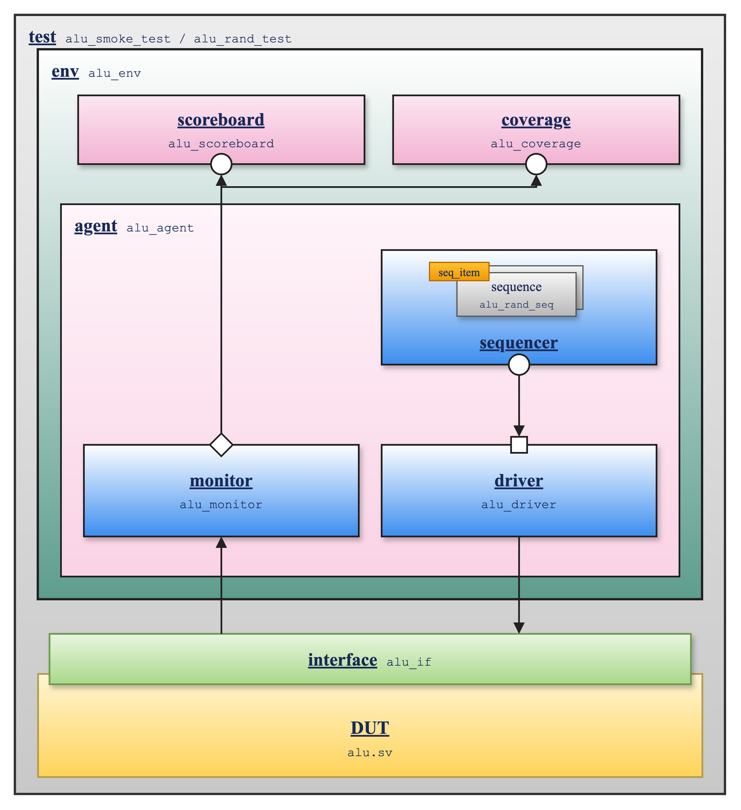

# UVM Testbench for the ALU

> *"Program testing can be used to show the presence of bugs, but never to show their absence!"*
> — Edsger W. Dijkstra

A UVM 2020.3.1 testbench for the core's ALU ([`src/alu.sv`](../../src/alu.sv)), run on Verilator: constrained-random stimulus, a scoreboard with an independent reference model, and functional coverage.

## Why I built this

My directed testbenches have writer's bias: I pick the inputs and work out the expected answers by hand, so they only check the cases I thought of. My original ALU testbench even prints `FAIL` without ever failing the run. Industry verification teams use UVM to close that gap, and I wanted to learn it by building one. I picked the ALU on purpose: it is the simplest block in the core, so the hard part would be the methodology and not the design.

## Results

| Test | Transactions | Mismatches | Functional coverage |
|------|--------------|------------|---------------------|
| `alu_smoke_test` | 20 | 0 | 11.8% |
| `alu_rand_test`, seed 1 | 10,000 | 0 | 99.00% |
| `alu_rand_test`, seed 2 | 10,000 | 0 | 98.50% |
| `alu_rand_test`, seed 3 | 10,000 | 0 | 98.17% |
| **Seeds 1–3 merged** | **30,000** | **0** | **100% (602/602 bins)** |

Each seed misses a different few rare bins (6, 9 and 11), so merged they hit all 602; `make uvm-alu-regress` reproduces the last four rows. With `$signed` removed from the RTL's SRA in a scratch copy, the scoreboard reported 99 mismatches in 3,000 transactions.

## How it fits together

<p align="center">
  
</p>

The sequencer hands each `seq_item` to the driver (○ to □); the monitor rebuilds every transaction from the pins and its analysis port (◇) broadcasts it to the scoreboard and coverage. Source: [`uvm_alu_tb.drawio`](../../docs/uvm/uvm_alu_tb.drawio).

| Component | Job |
|-----------|-----|
| `alu_item` | One operation: random `a`, `b`, `alu_ctrl`, weighted toward corner values (0, 1, `0x7FFFFFFF`, `0x80000000`, all-ones, checkerboards), with about 5% illegal opcodes and shift amounts weighted to 0, 1 and 31 |
| `alu_driver` | Drives one operation per clock through a clocking block and pulses `valid` |
| `alu_monitor` | Rebuilds each operation from the pins, publishing only when `valid` is high |
| `alu_scoreboard` | Reference model written from the RV32I spec, not from `alu.sv`: SRA from a sign-fill mask instead of `>>>`, SLT from the sign bits instead of `$signed`. Errors if it checked zero transactions |
| `alu_coverage` | 3 crosses (533 bins) plus 11 coverpoints, described below |
| `alu_if` | Testbench clock, driver and monitor clocking blocks, and an assertion that `zero == (result == 0)` |

## Coverage

| Cross | Bins | Covers |
|-------|------|--------|
| Register ops (ADD, SUB, AND, OR, XOR, SLT, SLTU) × `a` class × `b` class | 343 | Sign and overflow corners, strict compares |
| Shift ops × `a` class × shift amount × upper bits of `b` set or clear | 168 | Only `b[4:0]` is used; SRA vs SRL sign fill |
| Every legal op × `zero` flag | 22 | `zero` is correct for every op, not just SUB |

Illegal opcodes (`0xB`–`0xF`) and LUI's `b`-only behavior have their own coverpoints.

## Verilator limits found along the way

| Limitation | Measured | Workaround |
|------------|----------|------------|
| `soft` does not make a `dist` yield to an inline `randomize() with {}` | 11 of 200 randomizations succeeded | Non-rand knobs (`ctrl_dist_en`, `ab_dist_en`) that a sequence clears first: 300/300 |
| Two `dist`s on overlapping bits of `b` | 25% of `randomize()` calls failed | Guard them so only one applies per op: 0 failures in 2,000 |
| `ignore_bins ... binsof()` inside a `cross` is ignored | Coverage capped at about 40% by bins that could never be hit | Per-op-group coverpoints restricted with `iff`: 99% |
| Type-level `get_coverage()` always returns 0 | — | Report `get_inst_coverage()` |
| `$error` in an assertion stops the simulation before the UVM summary | — | `` `uvm_error `` in the assertion, counted like any mismatch |
| The simulator exits 0 even when UVM reports errors | — | `make uvm-alu` reads the UVM summary and fails on any error |

## Run it

```bash
make uvm-alu                              # alu_smoke_test, seed 1
make uvm-alu TEST=alu_rand_test SEED=7    # 10,000 transactions
make uvm-alu-regress                      # seeds 1-3, per-seed and merged coverage
```

Each run prints PASS or FAIL and writes a log and a coverage `.dat` to `sim/`. Compiling takes about 40 s, a 10,000-transaction run about 45 s, and `SEEDS="1 2 3 4 5"` picks the regression's seeds.

Requires Verilator 5.x with the z3 solver, and UVM 2020.3.1 at `UVM_HOME` (default `~/tools/uvm-core-2020.3.1/src`).

## Files

| File | What |
|------|------|
| `alu/alu_if.sv` | Interface, clocking blocks, zero-flag assertion |
| `alu/alu_pkg.sv` | Transaction, driver, monitor, agent, scoreboard, coverage, env, sequence, tests |
| `alu/tb_alu_uvm.sv` | Top module: clock, DUT, `run_test()` |
